# Encrypted TCP Chat System (Cross-Language AES-256-GCM)

A production-grade, low-level socket chat system implementing cross-language communication between a **C# (.NET 8)** server running on Linux and a **Python 3** client running on Android/Linux.

Built from scratch using native POSIX socket abstractions, featuring **AES-256-GCM authenticated encryption (AEAD)**, custom binary wire-framing, and full-duplex asynchronous concurrency.

---

## Key Architectural Features

- **POSIX Sockets Core**: Implemented using low-level BSD socket primitives (`bind`, `listen`, `accept`, `recv`, `send`) without relying on high-level HTTP, WebSocket, or RPC frameworks.
- **Cross-Language Interoperability**: Seamless byte-level compatibility between .NET 8 (`System.Security.Cryptography.AesGcm`) and Python 3 (`cryptography.hazmat`).
- **Authenticated Encryption with Associated Data (AEAD)**: Every message is encrypted using AES-256-GCM with a unique 12-byte cryptographically secure random nonce and a 16-byte authentication tag to guarantee confidentiality, authenticity, and tamper detection.
- **Binary Wire Protocol**: Custom length-prefixed framing (4-byte big-endian uint32 header) to eliminate TCP byte-stream fragmentation and chunk merging.
- **Full-Duplex Asynchronous I/O**: Multi-threaded concurrency (`threading.Thread` in Python, `Task.Run` in C#) enabling simultaneous transmission without half-duplex blocking.
- **LAN & WAN Verified**: Verified across physical Wi-Fi LAN and cellular 4G/5G WAN networks via reverse TCP tunneling (Pinggy/SSH).
- **Zero Plaintext Leakage**: Formally verified via Linux kernel packet analysis (`tcpdump`).

---

## Wire Protocol Specification

Every frame transmitted over the TCP stream follows this strict memory layout:

```text
 0                   1                   2                   3
 0 1 2 3 4 5 6 7 8 9 0 1 2 3 4 5 6 7 8 9 0 1 2 3 4 5 6 7 8 9 0 1
+-+-+-+-+-+-+-+-+-+-+-+-+-+-+-+-+-+-+-+-+-+-+-+-+-+-+-+-+-+-+-+-+

|                  Payload Length (4 Bytes, uint32)             |
+-+-+-+-+-+-+-+-+-+-+-+-+-+-+-+-+-+-+-+-+-+-+-+-+-+-+-+-+-+-+-+-+

|                       Nonce (12 Bytes)                        |
|                     (Random per message)                      |
+-+-+-+-+-+-+-+-+-+-+-+-+-+-+-+-+-+-+-+-+-+-+-+-+-+-+-+-+-+-+-+-+

|                      Auth Tag (16 Bytes)                      |
|                     (Integrity Checksum)                      |
+-+-+-+-+-+-+-+-+-+-+-+-+-+-+-+-+-+-+-+-+-+-+-+-+-+-+-+-+-+-+-+-+

|                 Ciphertext (Variable Length)                  |
|                      (Encrypted payload)                      |
+-+-+-+-+-+-+-+-+-+-+-+-+-+-+-+-+-+-+-+-+-+-+-+-+-+-+-+-+-+-+-+-+
```

```text
+--------------------+-------------------+-------------------+-----------------------+

|  Length (4 Bytes)  |  Nonce (12 Bytes) |   Tag (16 Bytes)  | Ciphertext (Variable) |
|  uint32 Big-Endian |   Random per msg  | Integrity Checksum|   Encrypted payload   |
+--------------------+-------------------+-------------------+-----------------------+
```

---

## System Architecture

```mermaid
sequenceDiagram
    autonumber
    actor MobileUser as Mobile Client (Python 3 / Termux)
    actor ServerAdmin as Server Host (C-Sharp .NET 8 / Ubuntu)
    participant Kernel as Linux TCP Socket & NAT / WAN Gateway

    Note over MobileUser, ServerAdmin: Layer 4: TCP 3-Way Handshake
    MobileUser->>Kernel: SYN (seq=x)
    Kernel->>MobileUser: SYN-ACK (seq=y, ack=x+1)
    MobileUser->>Kernel: ACK (ack=y+1)
    Kernel->>ServerAdmin: AcceptTcpClient() returns active Socket

    Note over MobileUser, ServerAdmin: Layer 7: AES-256-GCM Full-Duplex Encrypted Stream
    rect rgb(30, 30, 45)
        Note right of MobileUser: Encrypt: AESGCM(Key)<br/>Payload = Nonce(12B) + Tag(16B) + Ciphertext(NB)<br/>Framing: [Length (4B Big-Endian)] + Payload
        MobileUser->>ServerAdmin: Wire Packet (Length + Nonce + Tag + Ciphertext)
        Note left of ServerAdmin: ReadExact(4) -> Parse uint32<br/>ReadExact(Length) -> Span<byte> Slicing<br/>AesGcm.Decrypt(Nonce, Ciphertext, Tag)
    end

    rect rgb(30, 30, 45)
        Note left of ServerAdmin: Encrypt: AesGcm(Key)<br/>Payload = Nonce(12B) + Tag(16B) + Ciphertext(NB)<br/>Framing: [Length (4B Big-Endian)] + Payload
        ServerAdmin->>MobileUser: Wire Packet (Length + Nonce + Tag + Ciphertext)
        Note right of MobileUser: recv_exact(4) -> struct.unpack('>I')<br/>recv_exact(Length) -> Slicing<br/>AESGCM.decrypt(Nonce, Combined, None)
    end

    Note over MobileUser, ServerAdmin: Graceful Connection Teardown
    MobileUser->>ServerAdmin: FIN Packet (/quit)
    ServerAdmin->>MobileUser: ACK + FIN Packet
    Note over MobileUser, ServerAdmin: Sockets Disposed & Ports Reusable (SO_REUSEADDR)
```



---

## Project Structure

```text
encrypted-chat/
├── csharp-server/
│   ├── Program.cs           # Async C# TCP server (Task.Run worker)
│   ├── Protocol.cs          # .NET AES-256-GCM wire framing & Span slicing
│   └── csharp-server.csproj # .NET 8 project file
├── client.py                # Multithreaded Python TCP client
├── server.py                # Python TCP baseline server
├── protocol.py              # Python AES-256-GCM wire framing (recv_exact)
├── crypto_demo.py           # Standalone Python cryptographic test & tamper checks
├── crypto-demo-csharp/      # Standalone C# cryptographic verification
├── syntax-gym-python/       # Python socket/byte manipulation drills
├── syntax-gym-csharp/       # C# socket/byte manipulation drills
└── README.md                # System documentation & architectural spec
```

---

## Quick Start Guide

### Prerequisites

- Linux/Ubuntu host with **.NET 8 SDK** installed
- **Python 3.10+** with `cryptography` library installed:

```bash
pip install cryptography
```

### 1. Run the C# Server

```bash
cd csharp-server
dotnet run
```

The server will bind to `0.0.0.0:5000` and listen for incoming connections across all local and virtual interfaces.

### 2. Run the Python Client

```bash
python3 client.py
```

*(Configure the server destination IP inside `client.py` if connecting from another device on LAN or via a WAN reverse tunnel).*

---

## Security & Forensic Verification

Live packet sniffing conducted with `tcpdump` confirms complete confidentiality on the physical wire:

```bash
sudo tcpdump -i any -X -s 0 port 5000
```

```text
22:44:46.827835 IP 192.168.0.107.42086 > lone-wolf-Aspire.5000: Flags [P.], length 49
	0x0030:  f1d3 63e3 0000 002d b52c 392b dbd7 2320  ..c....-.,9+..#.
	0x0040:  80f7 f719 4a69 b43a 3ee8 a0c0 9b19 8b69  ....Ji.:>......i
	0x0050:  147b 6d2e f1a5 ab6f a27d 9043 2755 ebe0  .{m....o.}.C'U..
	0x0060:  7852 1eea 56                             xR..V
```

- **Zero Plaintext Leakage**: All payload data, including protocol headers and random nonces, presents as high-entropy binary ciphertext.
- **Cryptographic Tamper Defense**: Any bit modification to in-transit frames triggers an immediate `InvalidTag` (Python) or `CryptographicException` (C#), aborting payload processing.

